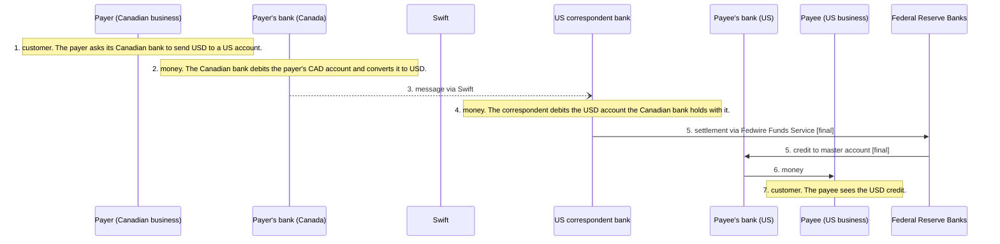

# Settlement Map V9 · Phase 1 Canada

Branch `settlement-map-v9-canada`, cut from `settlement-map-v9-preview`. Nothing here touches the Render build or production. The V8 tarball and `v9-overrides/` are unchanged.

**What's in the branch**

| Path | What it is |
|---|---|
| `data/atlas.json` | The one data file. 10 systems, 12 parties, 1 scenario, 15 sources |
| `data/atlas.schema.json` | JSON Schema (draft 2020-12) for system, scenario, source, party, group |
| `design/tokens.json` | Colour and line tokens. The prototype must contain every value |
| `scripts/check.mjs` | `npm run check` (drift tests), `npm run check:self` (fixtures), `npm run mermaid` |
| `tests/fixtures/*.json` | Ten deliberately broken patches. Each must fail the test it targets |
| `prototype/canada/index.html` | L1 to L4 plus Railroom, reading `data/atlas.json` |
| `scripts/build-preview.mjs` | Inlines the data into one file for a private review link (`dist/`, ignored) |

Run it with `npm install`, `npm run check:self`, then `npx serve .` and open `/prototype/canada/`.

---

## 1. Seven top-level groups

All seven are kinds of payment infrastructure, grouped by what the system does to money. Region is a filter.

| # | Group | Phase 1 records |
|---|---|---|
| 1 | High-value and central bank settlement | Lynx, Bank of Canada settlement accounts, Fedwire Funds, Federal Reserve master accounts |
| 2 | Batch clearing | ACSS (AFT and USBE noted inside the record) |
| 3 | Instant payments | RTR (planned), Interac e-Transfer |
| 4 | Card networks | Visa in Canada, Mastercard in Canada |
| 5 | Cross-border messaging and FX settlement | Swift |
| 6 | Stablecoins and tokenized money | none yet |
| 7 | Customer-facing services | none yet |

**Where I disagree with the brief**

- The current V9 homepage seven are the layers, and those are all the same kind of thing (functions a provider performs). The mixing the brief describes was in the V8 navigation, which put systems, participants, markets, corridors and holding models side by side. So I would not throw the layers away. They become the `roles[]` tag on each record and the "who does what" lens on parties. The seven groups above index the systems.
- Group 7 renamed from "wallets and super-apps" to "Customer-facing services" so Wise-type providers fit without a new group.
- Interac e-Transfer stays in Instant payments even though it settles the next day on a deferred net basis. That contrast is the most useful thing the map can teach, and the settlement drill shows it.

**Where the existing V8 items move**

| V8 item | Moves to |
|---|---|
| systems/lynx, boe-rtgs, chaps, fedwire, chips, us-federal-reserve, uk-boe | Group 1 |
| systems/acss, fedach, epn, us-ach, bacs | Group 2 |
| systems/rtr, interac-e-transfer, interac, rtp, fednow, faster-payments, upi, pix, spi | Group 3 (DICT becomes a component inside the Pix record) |
| participants/visa, mastercard | Group 4 as systems, and kept as parties |
| participants/swift | Group 5. CLS and CIPS join in Phase 2 |
| participants/circle | Group 6 as USDC, with Circle, BlackRock and BNY as three parties |
| participants/wise, airwallex, marqeta, subfunctions/consumer-apps | Group 7 or parties only (Marqeta is a processor, not a system) |
| participants/payments-canada, bank-of-canada, federal-reserve, clearbank, banco-central-do-brasil | Parties, linked from the systems they operate |
| markets/* | Region filter |
| corridors/* | Railroom scenarios |
| holding/* | An L4 section on party records ("where the money sits") |
| layers/*, subfunctions/* | `roles[]` tags |
| systems/architecture, changes, methodology | Methodology page |

---

## 2. Wireframes (Canada, RTR)

**Two drill axes.** Across, the breadcrumb (World › group › region › system). Down, the settlement path inside the panel (system › where it settles › central bank). "Drill up" lists every system that settles into the one you are looking at.

**L1 World · desktop**
```
Settlement Map  Fintech North                          Atlas | Railroom
World
Region [All] [Canada] [United States] [Global]

Who settles what, and where it ends up
──────────────────────────────────────────────────────────────────────
High-value and central bank settlement                     4 systems
  Systems where large or time-critical payments settle one by one...
──────────────────────────────────────────────────────────────────────
Batch clearing                                              1 system
──────────────────────────────────────────────────────────────────────
Instant payments                                           2 systems
──────────────────────────────────────────────────────────────────────
Stablecoins and tokenized money                              Phase 2
```

**L2 group · desktop, with L3 panel open**
```
World › Instant payments › Canada › RTR
──────────────────────────────────────────┬───────────────────────────
System        Operator   Settles in  Timing│ Real-Time Rail (RTR) planned   [Close ×]
CA RTR planned Payments C BoC accts ↓ 24/7 │ Instant payments · Canada
CA e-Transfer  Interac    Lynx ↓      T+1  │ Operator        Payments Canada
                                          │ Participants    Regulated FIs and RPAA PSPs
                                          │ Settlement asset Central bank money (CAD)
                                          │ Hours           24/7/365 (planned)
                                          │ Settles in      Bank of Canada settlement accounts
                                          │ Two-sentence explainer
                                          │ Source: Payments Canada, Bank of Canada. Checked 31 Oct 2026
                                          │ SETTLEMENT PATH
                                          │ ● RTR        Real time, funded account
                                          │ ║
                                          │ ○ BoC accounts   Final. Central bank money (CAD)
                                          │ [↓ Drill down to BoC accounts] [↑ Settles here (0)]
                                          │ L4  + Rulebook and operator
                                          │     + Participants
                                          │     + Caveats
                                          │     + Not known yet
                                          │     + All sources
```

**Phone**
```
Settlement Map          Atlas Railroom
World › Instant payments › RTR
[All][Canada][US][Global]
Instant payments
RTR  planned
  Operator   Payments Canada
  Settles in BoC accounts ↓      ← table becomes stacked rows, nothing hidden
━━━━━━━━━━━━━━━━━━━━━━━━━━━━━━━━━━  bottom sheet, half height
[Full height]            [Close ×]
Real-Time Rail (RTR) planned
facts · explainer · source
settlement path · drill buttons
L4 disclosures
```

L4 sections are closed by default. Esc and Back close the panel and return focus to the row.

---

## 3. Schema and Canada records

The schema is `data/atlas.schema.json`. Three rules carry most of the weight.

- `field_sources` maps each claim field to source ids. A field with a value and no source fails the build.
- `settles_in` points at another system. That single field is what makes the drill down and drill up work.
- `settlement_mode` is one of `rtgs`, `deferred-net`, `real-time-funded`, `central-bank-ledger`, `pvp`, `on-chain`, `none`, `unknown`. Unknown is allowed and shown as "Not confirmed".

**Canada settlement paths in the data**

| System | Settles in | Mode and timing | Primary source |
|---|---|---|---|
| Lynx | Bank of Canada accounts | RTGS, real time | Payments Canada (Lynx page), Bank of Canada account policy |
| ACSS | Lynx | Deferred net, previous day's balances settle next business morning | Payments Canada (ACSS page), Bank of Canada account policy ("meet their net settlement obligations by Lynx payments") |
| Interac e-Transfer | Lynx | Deferred net, day after the value date | Interac PPS self-assessment, as at 2025-04-30 |
| RTR (planned) | Bank of Canada accounts | Real time, accounts funded and defunded by Lynx payments | Payments Canada RTR FAQ, Bank of Canada RTR account policy (2026-07-31) |
| Visa, Mastercard in Canada | Not confirmed | Not confirmed | Bank of Canada oversight list names the operators only |

The full records, with every source, are in `data/atlas.json`.

---

## 4. Line grammar and contrast

```css
--line-message: 1px;      /* dashed 4 3, open arrowhead, ink */
--line-money: 2.5px;      /* solid, filled arrowhead, ink */
--line-settlement: 2.5px; /* double line, accent, ends in the settlement column, labelled "final" */
/* customer step: plain label in the lane, no line */
```
SVG markers `m-open` and `m-fill` are in the prototype. Line type is readable without colour (dash, weight, double line, label).

`npm run check` computes this table from `design/tokens.json`.

| Theme | Pair | Ratio | Needs |
|---|---|---|---|
| light | ink on paper | 15.48 | 4.5 |
| light | muted on paper | 6.56 | 4.5 |
| light | accent on paper | 8.03 | 4.5 |
| light | planned on paper | 6.52 | 4.5 |
| light | ink on selected row | 13.67 | 4.5 |
| light | accent on selected row | 7.09 | 4.5 |
| light | rule-strong on paper (UI) | 3.37 | 3.0 |
| dark | ink on paper | 14.68 | 4.5 |
| dark | muted on paper | 7.15 | 4.5 |
| dark | accent on paper | 8.42 | 4.5 |
| dark | planned on paper | 9.38 | 4.5 |
| dark | rule-strong on paper (UI) | 4.19 | 3.0 |

The light hairline `rule` colour is decorative only. Anything a reader has to see uses `rule-strong` or darker.

---

## 5. Canada to US flow


Generated from the data by `npm run mermaid`, so it cannot drift from the steps.

| Step | Caption | Source |
|---|---|---|
| 1 | The payer asks its Canadian bank to send USD to a US account | BIS CPMI correspondent banking |
| 2 | The bank debits the payer's CAD account and converts it. A book entry, not an interbank payment | BIS CPMI |
| 3 | Instruction to the US correspondent over Swift. Swift moves no money | Swift, BIS CPMI |
| 4 | The correspondent debits the Canadian bank's USD account on its books | BIS CPMI |
| 5 | Fedwire to the payee's bank. The master account credit is final | Federal Reserve Financial Services |
| 6 | The payee's bank credits the payee | BIS CPMI |
| 7 | The payee sees the USD credit | BIS CPMI |

No CAD interbank settlement happens in this flow, which surprises most readers. If the payee banks with the correspondent, step 5 becomes a book transfer.

---

## 6. Drift tests

| Test | Fails when | Fixture that proves it |
|---|---|---|
| schema | A record breaks the JSON Schema | any |
| unique-ids | Two records share an id | n/a |
| every-claim-sourced | A field has a value but no source, or cites a missing source | `03-unsourced-hours`, `08-missing-source-id` |
| explainer-two-sentences | An explainer runs past two sentences | `04-three-sentences` |
| referential-integrity | `settles_in`, operator, group, lane or step party points at nothing | `05-dangling-settles-in` |
| settlement-chain-terminates | A settlement path loops, or ends somewhere that is neither a central bank ledger nor a declared unknown | `06-settlement-loop` |
| live-never-depends-on-planned | A live system settles in a planned one (Interac in RTR today) | `07-live-on-planned` |
| role-tags | Swift gets a settlement role, Interac moves off Lynx, ACSS stops settling in Lynx, UPI not in RBI RTGS, CHIPS/RTP not on their NY Fed accounts, USDC without three distinct parties | `01-swift-settles`, `02-interac-in-acss`, `10-upi-wrong` |
| freshness | A record or source is older than 180 days (warning), or a source document is over 12 months old (warning) | live warnings today on four older documents |
| contrast | A token pair drops below 4.5:1 text or 3:1 UI | `09-low-contrast` (the 3.7:1 problem) |
| tokens-match-prototype | The prototype CSS stops matching `design/tokens.json` | n/a |

UPI, CHIPS, RTP and USDC tests report "pending" until Phase 2 loads those records. Link checking is opt-in (`npm run check:links`) because the network is flaky in CI.

---

## 7. Facts in §3 I would correct or tighten

- **Interac e-Transfer (new).** It settles on a deferred net basis through Lynx, the day after the value date, not through ACSS. Interac does not hold participant funds. The old Canada drilldown mockup hedged on this. Source is Interac's PPS self-assessment, as at 2025-04-30.
- **RTP.** Settlement happens by debits and credits on ledger positions RTP maintains, and those positions are backed by funds in a joint account at the New York Fed. So the ledger is TCH's and the backing is central bank money. Saying it "settles at the NY Fed" overstates it. Source is the Federal Reserve Board order on RTP joint account balances, 2023-06-07.
- **CHIPS and RTP.** Each has its own prefunded account at the New York Fed. They are not one shared joint account. I did not reverify CHIPS mechanics on a primary source this pass, so treat that line as a read.
- **UPI.** Confirmed. NPCI calculates each member's net position and settlement runs through members' RTGS accounts with RBI, inside the existing IMPS settlement file. Source is NPCI's UPI settlement process note (undated).
- **RTR.** Not live as of 31 Oct 2026. The by-law and rules took effect 24 Aug 2026 and launch is planned for Q4 2026.
- **USDC.** Not reverified this pass. The three-party split stands, but the reserve also holds cash at banks outside the BlackRock fund, so "BlackRock manages the reserve" should read "manages the Circle Reserve Fund portion".
- **Card settlement in Canada.** I could not find a primary source for where Visa and Mastercard CAD net amounts finally settle. Shown as "Not confirmed" rather than guessed.

---

## 8. What I would cut

- The ⌘K command menu. Ten systems and a region filter do not need search. Add it past about 60 records.
- The optional world map on L1. Rows carry it.
- Rail-swap small multiples until there are at least two sourced Canada flows to compare.
- The conversational Railroom mode until there are four or more sourced scenarios.
- Separate Railroom data. It already reads the same file.
- Flags at Phase 1. The two-letter ISO chip does the job and avoids an asset pipeline.

**Small deviations from the brief.** The settlement lane is the last column of the sequence diagram rather than a band underneath, because steps run down the page. The private preview link uses `#rtr` style links because the artifact frame only keeps a plain hash. The repo prototype uses `?system=rtr` as specified.
